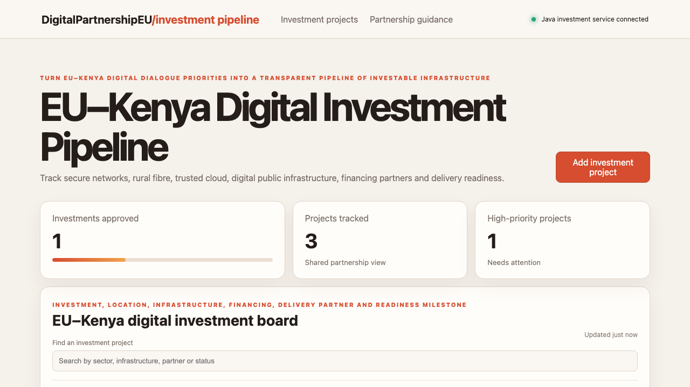

# EU–Kenya Digital Investment Pipeline

Turn digital-partnership priorities into a clear pipeline of financed, accountable infrastructure projects.

## Live demo

Run the frontend and backend locally with the installation steps below, then open `http://localhost:4200`.

## Screenshots

## Main features

- Search and sort investments by infrastructure, partner, status or priority.
- Create projects and advance real backend records through delivery review.
- Summarise approved investments, portfolio size and priority projects.
- Present partnership guidance alongside the operational pipeline.

## Technology used

Angular, TypeScript, signals, computed state, HttpClient, Vitest, Spring Boot, Jakarta Validation, JUnit and Maven.

## Installation instructions

Use Node.js 20+, Java 21 and Maven 3.9+. Run `npm install`, then start the API with `cd backend && mvn spring-boot:run`. In another terminal run `npm start`.

## Commercial licensing/contact

Commercial licensing and implementation enquiries: `100402995+Amitesh2022@users.noreply.github.com`.

## Business problem and users

Public authorities, infrastructure operators, development financiers and delivery partners need a common view of strategic value, readiness and accountability.

## Key workflows

Find a project, create an investment through the Java API, inspect partner ownership, advance readiness and review partnership guidance.

## Angular framework highlights

Standalone components, signals, computed filters, OnPush change detection, HttpClient and modern template control flow demonstrate native Angular state and rendering.

## Java backend highlights

Spring Boot exposes validated list, search, create and update endpoints, structured errors, a health endpoint, service/domain separation and JUnit tests.

## Architecture and state flow

Angular HttpClient reads and writes `/api/items`; Spring Boot validates each request; signals then render the authoritative response and derived metrics.

## Accessibility and responsive behaviour

Semantic sections, labelled search, visible priorities, keyboard controls and responsive grids preserve clarity on desktop and narrow screens.

## Verification commands

Run `npm test`, `npm run lint`, `npm run build`, `cd backend && mvn test` and `mvn package`.

## Structure

`src/app/` contains the Angular experience, `backend/` contains the Java service, and `docs/` contains reviewed product media.

## Tradeoffs

In-memory storage makes the product portable; production use would add financing models, durable persistence, permissions and procurement integrations.

## Roadmap

Add geospatial views, financing-gap analysis, dependency tracking, local-impact measures and multilingual partnership reports.
